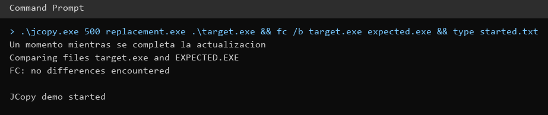

# JCopy

[English](#english) · [Español](#español)

## English

Legacy Windows command-line tool that waits a set time, replaces an executable and starts it

> [!WARNING]
> **Status: Legacy.** Code from 2004. Builds with the converted solution on Windows 11, verified 18 November 2026.

### Overview

JCopy handles the final step of a software update when a replacement executable is already available. It waits the number of milliseconds you give it, then attempts to delete the destination, move the replacement to that path, and start it there. The delay is a timer. Close the original program before running the example.

### Features

- Run `jcopy.exe` with no arguments to see the usage line.
- Run `jcopy.exe delay source destination` with all three arguments. With only two, the tool still tries to read a third. The delay is in milliseconds, the source is the replacement executable, and the destination is the file to replace.
- Check the resulting files after the command. JCopy reports that the update is in progress and returns zero without checking the results of the file operations or launch.

### Requirements

| Component | Version | Used for |
| --- | --- | --- |
| Windows | Minimum version unknown. Tested on Windows 11 Pro (10.0.26300) | Run the Win32 console program |
| Visual Studio Community 2026 | 18.10.3 (`18.10.12224.181`) | Install the **Desktop development with C++** workload and open its x86 tools prompt |
| MSVC v145 and Windows SDK | MSVC 14.51.36231 (compiler 19.51.36260, x86) and Windows SDK 10.0.26100.0 | Build the Win32 executable from [`jcopy.sln`](jcopy.sln) |
| Historical Visual C++ project | Visual Studio .NET 2002 project format `7.00` | [`jcopy.vcproj`](jcopy.vcproj) records the original project settings |

### Getting started

Open an **x86 Native Tools Command Prompt for Visual Studio** in a copy of the repository and run:

```bat
MSBuild.exe jcopy.sln /t:Build /p:Configuration=Release /p:Platform=Win32 /nologo
.\Release\jcopy.exe
```

The build creates `Release\jcopy.exe`. With no arguments, it prints `Uso: jcopy [retardo] [desde] [hasta]`. For a Debug build, change `Configuration=Release` to `Configuration=Debug`. The result is `Debug\jcopy.exe`. To build in Visual Studio, open `jcopy.sln` and select **Release** or **Debug** with platform **Win32**.

### Usage

JCopy can delete the destination and run the file at that path. Use only disposable files and relative names without spaces. Supply all three arguments.

1. In the same x86 prompt, create and enter a temporary directory with a copy of the compiled utility. Continue after the three operations succeed.

   ```bat
   set "JCOPY_DEMO=%TEMP%\jcopy-demo-%RANDOM%-%RANDOM%"
   mkdir "%JCOPY_DEMO%" && copy Release\jcopy.exe "%JCOPY_DEMO%\jcopy.exe" && pushd "%JCOPY_DEMO%"
   ```

2. Save this code in `demo.cpp`. When JCopy starts the demo, it creates `started.txt` in the test directory.

   ```cpp
   #include <fstream>

   int main() {
       std::ofstream("started.txt") << "JCopy demo started\n";
   }
   ```

3. Compile the demo, preserve a reference copy, and create a disposable destination.

   ```bat
   cl /nologo /EHsc /Fe:replacement.exe demo.cpp
   copy replacement.exe expected.exe
   > target.exe echo Disposable test file
   ```

4. Run JCopy with a delay of 500 milliseconds and compare the files. If needed, wait briefly for the launched program to write its marker before using `type`. After a successful run, `replacement.exe` is gone, `fc /b` reports no differences, and the marker reads `JCopy demo started`.

   ```bat
   .\jcopy.exe 500 replacement.exe .\target.exe
   fc /b target.exe expected.exe
   type started.txt
   popd
   ```

### Contributing

This repository is kept for reference. Contributions are closed.

### Support

Use [GitHub Issues](https://github.com/plaspy-dev/JCopy/issues) for questions about the archived source. Include the command and toolchain version when reporting a build issue.

### History

The five recovered project files are dated 12 September 2004. Their timestamps have no time zone, so the reconstructed author date uses 12:00 UTC. The first commit also carries the solution, converted C++ project, README, Git ignore rules and MIT license added during the 2026 reconstruction.

### Verification

Tested on 18 November 2026 on Windows 11 Pro (10.0.26300). MSBuild 18.10.1.42706 built `jcopy.sln` for Win32 in Release and Debug in separate copies of the two commits. Both used Visual Studio Community 18.10.3, the v145 toolset and the Windows SDK versions listed above.

In both builds, running JCopy with no arguments printed the expected usage line. With the three arguments from **Usage**, JCopy replaced the disposable destination and started the demo. `fc /b` confirmed that the new destination matched the reference byte for byte. The source file disappeared and the launched demo wrote `JCopy demo started` to `started.txt`.



The capture uses Release and shows actual console output rendered with Python 3.12.4 and Pillow 12.2.0.

### License

[MIT License](LICENSE).

---

## Español

Legado — utilidad de consola para Windows que espera un tiempo fijo, reemplaza un ejecutable y lo inicia

> [!WARNING]
> **Estado: legado.** Código de 2004. Compilación con la solución convertida en Windows 11 comprobada el 18 de noviembre de 2026.

### Descripción general

JCopy se ocupa del último paso de una actualización cuando el ejecutable nuevo ya está disponible. Espera los milisegundos que indiques, luego intenta borrar el destino, mover el reemplazo a esa ruta e iniciarlo desde allí. La espera se controla con un temporizador. Cierra el programa anterior antes de ejecutar el ejemplo.

### Funciones

- Ejecuta `jcopy.exe` sin argumentos para ver la línea de uso.
- Ejecuta `jcopy.exe retardo origen destino` con los tres argumentos. Si pasas solo dos, la utilidad intenta leer un tercero. El retardo va en milisegundos, el origen es el ejecutable de reemplazo y el destino es el archivo que se sustituye.
- Comprueba los archivos después de ejecutar el comando. JCopy avisa que la actualización está en curso y devuelve cero sin comprobar el resultado de las operaciones de archivo ni del inicio del programa.

### Requisitos

| Componente | Versión | Para qué se usa |
| --- | --- | --- |
| Windows | Versión mínima desconocida. Prueba en Windows 11 Pro (10.0.26300) | Ejecutar el programa de consola Win32 |
| Visual Studio Community 2026 | 18.10.3 (`18.10.12224.181`) | Instalar la carga **Desarrollo para el escritorio con C++** y abrir su símbolo del sistema para x86 |
| MSVC v145 y SDK de Windows | MSVC 14.51.36231 (compilador 19.51.36260, x86) y SDK de Windows 10.0.26100.0 | Compilar el ejecutable Win32 desde [`jcopy.sln`](jcopy.sln) |
| Proyecto histórico de Visual C++ | Formato de proyecto `7.00` de Visual Studio .NET 2002 | [`jcopy.vcproj`](jcopy.vcproj) conserva la configuración original del proyecto |

### Cómo empezar

Abre el **Símbolo del sistema de herramientas nativas x86 para Visual Studio** en una copia del repositorio y ejecuta estos comandos.

```bat
MSBuild.exe jcopy.sln /t:Build /p:Configuration=Release /p:Platform=Win32 /nologo
.\Release\jcopy.exe
```

La compilación crea `Release\jcopy.exe`. Si lo ejecutas sin argumentos, muestra `Uso: jcopy [retardo] [desde] [hasta]`. Para compilar en Debug, cambia `Configuration=Release` por `Configuration=Debug`. El resultado queda en `Debug\jcopy.exe`. Si prefieres compilar en Visual Studio, abre `jcopy.sln` y selecciona **Release** o **Debug** con la plataforma **Win32**.

### Uso

JCopy puede borrar el archivo de destino y ejecutar el que quede en esa ruta. Usa solo archivos desechables y nombres relativos sin espacios. Pasa los tres argumentos.

1. En el mismo símbolo del sistema para x86, crea una carpeta temporal con una copia de la utilidad compilada y entra en ella. Continúa cuando se completen las tres operaciones.

   ```bat
   set "JCOPY_DEMO=%TEMP%\jcopy-demo-%RANDOM%-%RANDOM%"
   mkdir "%JCOPY_DEMO%" && copy Release\jcopy.exe "%JCOPY_DEMO%\jcopy.exe" && pushd "%JCOPY_DEMO%"
   ```

2. Guarda este código en `demo.cpp`. Cuando JCopy inicia la demostración, esta crea `started.txt` en la carpeta de prueba.

   ```cpp
   #include <fstream>

   int main() {
       std::ofstream("started.txt") << "JCopy demo started\n";
   }
   ```

3. Compila la demostración, conserva una copia de referencia y crea un destino desechable.

   ```bat
   cl /nologo /EHsc /Fe:replacement.exe demo.cpp
   copy replacement.exe expected.exe
   > target.exe echo Disposable test file
   ```

4. Ejecuta JCopy con un retardo de 500 milisegundos y compara los archivos. Si hace falta, espera un momento a que el programa iniciado escriba el archivo de confirmación antes de usar `type`. Cuando la prueba funciona, `replacement.exe` desaparece, `fc /b` indica que los archivos coinciden y `started.txt` contiene `JCopy demo started`.

   ```bat
   .\jcopy.exe 500 replacement.exe .\target.exe
   fc /b target.exe expected.exe
   type started.txt
   popd
   ```

### Contribuir

Este repositorio se conserva como referencia. Las contribuciones están cerradas.

### Soporte

Usa las [incidencias de GitHub](https://github.com/plaspy-dev/JCopy/issues) para consultar sobre el código archivado. Incluye el comando y la versión de las herramientas si informas de un problema de compilación.

### Historia

Los cinco archivos recuperados del proyecto tienen fecha del 12 de septiembre de 2004. Las marcas de tiempo carecen de zona horaria, por lo que la fecha de autor reconstruida usa las 12:00 UTC. El primer commit también contiene la solución, el proyecto de C++ convertido, el README, las reglas de exclusión de Git y la licencia MIT que se añadieron durante la reconstrucción de 2026.

### Verificación

Prueba realizada el 18 de noviembre de 2026 en Windows 11 Pro (10.0.26300). MSBuild 18.10.1.42706 compiló `jcopy.sln` para Win32 en Release y Debug en copias separadas de los dos commits. Ambas usaron Visual Studio Community 18.10.3, el conjunto v145 y la versión del SDK de Windows indicados arriba.

En las dos configuraciones, JCopy mostró la línea de uso esperada al ejecutarlo sin argumentos. Con los tres argumentos de **Uso**, JCopy reemplazó el destino desechable e inició la demostración. `fc /b` confirmó que el destino nuevo coincidía con la referencia byte por byte. El archivo de origen desapareció y la demostración iniciada escribió `JCopy demo started` en `started.txt`.


La captura usa Release y muestra la salida real de la consola, reproducida con Python 3.12.4 y Pillow 12.2.0.

### Licencia

[Licencia MIT](LICENSE).
